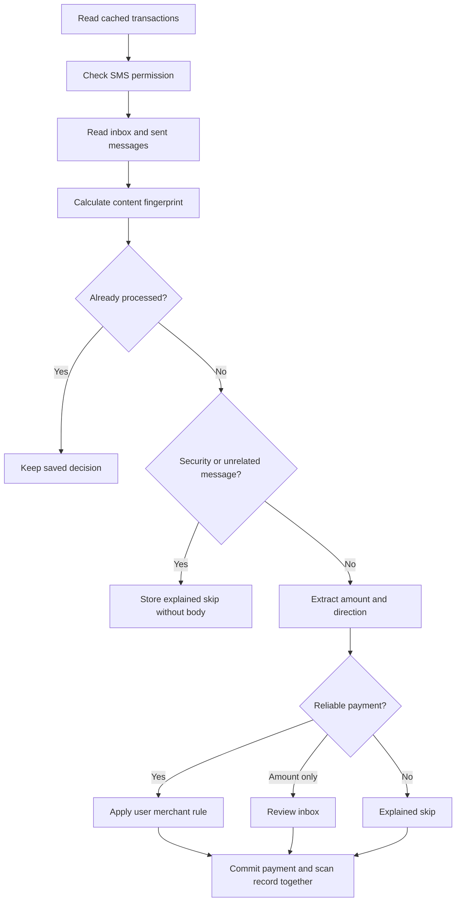

# Message parsing and interpretation

This document describes the first-release implementation. Parsing runs entirely on the device. It uses deterministic rules and user-created merchant rules; there is no AI model, server, or hardcoded category catalog.

## Pipeline

| Responsibility | Implementation |
| --- | --- |
| Permission, cache, incremental scan | [sms_service.dart](lib/services/sms_service.dart) |
| Android inbox and sent-folder access | [sms_reader.dart](lib/services/sms_reader.dart) |
| Stable SMS identity | [sms_fingerprint.dart](lib/services/sms_fingerprint.dart) |
| Transaction / review / skipped decision | [sms_processing_service.dart](lib/services/sms_processing_service.dart) |
| Amount, direction, source, merchant, account and reference extraction | [sms_parser.dart](lib/services/sms_parser.dart) |
| User merchant-rule matching | [category_service.dart](lib/services/category_service.dart) |
| Atomic persistence and first-release schema | [local_storage_service.dart](lib/services/local_storage_service.dart), [database_schema.dart](lib/services/database_schema.dart) |

## Reading and deduplication

Cached data is loaded before asking for SMS access. Denying SMS permission prevents a new scan; saved payments remain available. Concurrent scans are suppressed.

A first scan reads the available inbox and sent folders. Later scans start two days before the last successful scan start time to tolerate delayed messages. A requested lookback restricts the scan; a full recheck reads from the beginning. A batch writes at most 250 outcomes together. The scan watermark advances only after successful writes.

Android SMS row IDs are device-local and are not payment identities. Each message receives a SHA-256 ID over a JSON array containing:

1. Sender with its two-letter transport prefix removed, converted to uppercase.
2. Body with whitespace runs collapsed and surrounding whitespace removed.
3. The original SMS timestamp in milliseconds.
4. Inbox or sent-folder marker.

The fingerprint is used by the transaction, review, processed-SMS and processing-outcome records. Identical messages with identical timestamps and folders are deliberately deduplicated. Changing a timestamp or message text produces a different fingerprint; this is not fuzzy bank-reference deduplication. Restoring a backup clears the scan watermark and retains these content identities.

## Which messages are candidates?

Known financial sender patterns and the usual alphabetic bank sender format are recognized. An unfamiliar sender can still qualify when its message includes a rupee/amount indicator and a financial term such as account, UPI, bank, card, wallet, transaction, or `a/c`.

Personal sent messages are skipped unless the sender is recognized as a bank sender. A message with an OTP, one-time password, verification code, or login code is skipped without its body unless it also explicitly confirms a movement such as debited, credited, withdrawn, spent, paid to, or received from.

These are eligibility checks, not proof that a payment happened. A candidate still needs a usable amount and direction.

## Amount extraction

The parser reads currency-prefixed values (`Rs`, `Rs.`, `INR`, or the rupee symbol) and numeric `amount` / `amt` values. Commas are removed; up to two decimal places are accepted. Values must be positive and finite.

A currency value immediately following balance, available limit, credit limit, or outstanding text is excluded. For example, `Avl Bal: INR 9000. INR 500 debited` yields a payment of 500, not 9000.

Exactly one distinct usable value is required. Messages containing multiple different payment amounts are left unparsed rather than choosing the first number. Their retained payment-like body can be opened from skipped messages and the amount entered manually.

At the persistence boundary, rupees become integer paise. Transactions, balances, review amounts, budgets, salary amounts, and EMI amounts use integer database columns. Shared transaction totals add paise before converting to a display value. Currency displays retain paise for large values too.

## Direction and completion

Messages containing failed, declined, unsuccessful, pending, scheduled, due, requested, request-to-pay, will-be, not-debited, or not-credited wording are not automatically recorded as completed payments. This check is intentionally conservative and can also exclude a completed alert that mentions a separate pending payment or due date; inspect it through skipped messages.

For remaining messages:

- `credit card` and `debit card` are treated as product names and removed from the direction search.
- Explicit refund/reversal patterns (`refunded`, `reversed`, `cashback credited`, `refund credited`, `refund of`) select credit before considering purchase context.
- Credit indicators include credited, received, deposited, added, cashback, refund, and reversal.
- Debit indicators include debited, spent, paid, withdrawn, transferred to, purchase, charged, used, sent, payment to/of, txn of, and transaction of/at.
- Both opposing signals, or neither signal, produce unknown direction. Sender identity alone never forces a card alert to debit.

A positive amount with unknown direction goes to the review inbox. A user chooses Money In or Money Out, and confirmation atomically creates the transaction, removes the review item, and updates its scan outcome. Failed/pending messages do not enter this direction-only review path automatically.

## Other extracted information

- **Source:** UPI/wallet terms and sender patterns, card wording, then bank. Source describes a payment channel, not a category.
- **Merchant:** format-specific patterns such as UPI info segments, paid-to/received-from clauses, and card purchase descriptions. It can be absent.
- **Account suffix:** recognizable masked-account/card patterns retain the last four digits.
- **Reference:** UPI/IMPS/NEFT/RTGS/reference patterns are retained when available.
- **Balance:** extracted separately from the transaction amount.
- **Mapped account:** only a user-created sender mapping assigns the parent account. Unmapped senders retain their normalized sender name; there are no personal bank-name fallback mappings.

Bank format patterns are heuristics, not guarantees. Missing merchant/reference/account data does not invalidate an otherwise clear payment. Account reports group by mapped account ID or sender plus suffix, rather than suffix alone.

## One category system

Every payment has one nullable `categoryId`. The ID points to a record in `categories`; there is no standard/custom split, category enum, mandatory Uncategorized record, seeded merchant rule, or built-in category classifier.

A fresh install has zero categories. The user creates, renames, recolors, and deletes categories. An unmatched SMS remains uncategorized and still counts as spending. Salary and confirmed internal-transfer status are separate transaction fields.

Merchant rules are local user-created records with a match string, merchant name, optional category ID, optional tag, and enabled flag. Matching is case-insensitive substring matching against the SMS body. The longest match wins; newer rules win equal-length ties. Disabled rules never match.

An imported payment inherits the winning rule's merchant, category, and tag. A rule without a category leaves the payment uncategorized. Category provenance is `merchant_rule` or `user`; null means no assignment. Manual selection, including deliberately clearing a category, is protected when applying rule categories to saved transactions. The settings preview shows the category names before applying changes.

Renaming a category preserves its ID, transaction references, and budget. Deleting it atomically clears payment/review assignments, clears rule references, and deletes its budget. Payments, notes, and tags are retained. A rule may continue cleaning merchant names or adding its tag after its category is removed.

Budgets reference these same category IDs. Each category can have one budget, with a positive limit; names have no special financial meaning. Uncategorized spending and categories without budgets appear in Outside your budgets. If there are no categories, Add Budget opens category setup.

## Salary periods, transfers and totals

Salary cycles begin at a marked salary credit and end immediately before the next salary credit. Internally this is a half-open interval `[start, nextStart)`. Regenerating replaces the complete cycle set, including removing stale cycles when salaries are unmarked. Salary-day calendar periods clamp days 29-31 to the last day of shorter months.

Transfer detection proposes equal-amount debit/credit pairs within 24 hours, including across midnight. It considers timing, separate accounts, reference IDs, transfer language and payment channel. Ignored items, salaries, already-linked payments, and the same mapped account are excluded. A suggestion does not alter spending until the user confirms it.

Shared expense logic means debit, not ignored, not an internal transfer, and not salary. Income means credit, not ignored, and not an internal transfer. Budgets, salary summaries, category/account/merchant reports, heatmaps, recurring detection, and anomaly checks use these distinctions. Transaction lists can still show both transfer legs. Changing a linked payment's direction unlinks the pair atomically.

## Persistence and backups

Application version: `1.0.0+1`. Database, parser and backup format versions start at 1. The database file is `payment_tracker_release.db`. Creation directly installs the first-release schema; there are no legacy migration, backfill, catalog-seeding or old-backup conversion paths.

Foreign keys are enabled whenever the database is opened. Category/account edits update records in place, preserving references. A backup snapshot reads all tables inside one database transaction. Restore requires the complete current table/column shape and schema version and runs atomically; invalid references roll back the restore. Merge keeps records with an existing primary key; a conflicting unique category name or category budget aborts the merge rather than silently combining records.

User-initiated backups are encrypted with AES-256-GCM and password-derived keys in Android, with encryption/decryption and file I/O on a worker thread. Snapshot payloads are limited to 16 MB and encrypted input files to 32 MB. Passwords are not persisted. Android cloud backup/device-transfer extraction of app files is excluded. Only this first-release backup envelope is accepted.

## Outcomes and examples

| Message | Result |
| --- | --- |
| `INR 500 debited from your account for UPI payment.` | Debit, amount 500; category null unless a user rule matches |
| `Your credit card was used for INR 200 at SHOP.` | Debit, amount 200 |
| `Refund of INR 200 for purchase at SHOP credited.` from OneCard | Credit, amount 200 |
| `Avl Bal: INR 9000. INR 500 debited from your account.` | Debit, amount 500 |
| `INR 500 transaction alert for your account.` | Review inbox; direction unclear |
| `Rs.500 payment failed, account not debited.` | Skipped: payment not completed |
| `INR 100 debited and INR 200 debited.` | Skipped: no single reliable amount |
| OTP without completed-payment wording | Skipped without retaining the SMS body |
| Ordinary nonfinancial message | Skipped without retaining the SMS body |

Processing metadata records transaction, needsReview, or skipped, together with a reason and folder. Skipped reasons include security_message, sent_unrecognized, sender_not_recognized, no_amount_indicator, amount_not_found, not_completed, and not_a_payment. Skipped payment-like bodies are retained locally for inspection; review items and confirmed transactions retain their source message. Rechecking clears processed markers only for retained skipped payment-like messages, preserving edits and ignored decisions.

## Verification and remaining limits

[Core tests](test/core_services_test.dart) cover routing, rule precedence, review, export and date windows. [First-release tests](test/first_release_test.dart) exercise the real SQLite schema, category lifecycle, foreign keys, money, salary boundaries, backup rollback, fingerprinting, parser corrections, anomalies, and transfer matching.

Rule parsing cannot understand every bank template. Distinct alerts for the same real payment can still appear twice if their content or timestamps differ; duplicate alerts invite review. Sender-to-account mapping is one sender to one account and may require a manual account correction when a bank shares a sender across several accounts. Physical-device checks remain necessary for SMS permission prompts, document pickers, password failure/cancellation, and representative real bank messages.
